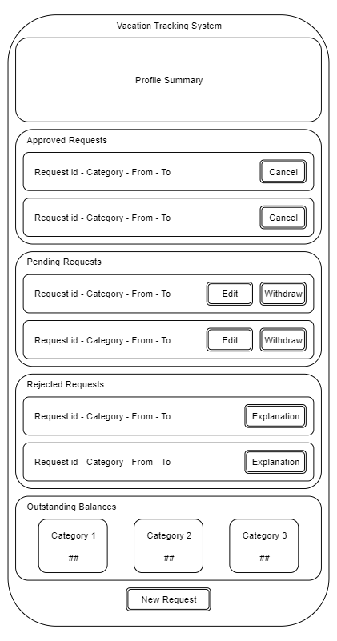

## Requests UI



## What if we need to have in the future another status like HR_Pending, HR_Approval with minimum change?

In the new data model, request state is modeled as a separate table to facilitate extension.

- Entity Relationships Diagram

- Relational Data Model


## Request State Machine


## Request Sequence Diagram


## Alternate Flow: Withdraw Request

- Flowchart

- Sequence Diagram

- Pseudocode
```
navigateToVTS() {
	lookUpRequestsAndBalances();
	displayRequestsAndBalances();
	// Employee selects a pending request to withdraw
	if(EmployeeWantstoWithdrawRequest) {
		promptForConfirmation();
		if(confirmed) {
			updateInDbAsWithdrawn();
			removeFromManagerView();
			sendEmailToManager();
		}
		returnToHomePage();
	}
}
```

## Alternate Flow: Cancel Approved Request

- Flowchart

- Sequence Diagram

- Pseudocode
```
navigateToVTS() {
	lookUpRequestsAndBalances();
	displayRequestsAndBalances();
	// Employee selects an approved request to cancel
	if(EmployeeWantstoCancelRequest) {
		if(cancellable) {
			promptForConfirmation();
			if(!futureRequest) {
				promptForExplanation();
			}
			if(confirmed) {
				updateInDbAsCanceled();
				returnBalances();
				removeFromManagerView();
				sendEmailToManager();
			}
		} else {
			alertUnCancellable();
		}
		returnToHomePage();
	}
}
```

## Alternate Flow: Edit Pending Request

- Flowchart

- Sequence Diagram


- Pseudocode
```
navigateToVTS() {
	lookUpRequestsAndBalances();
	displayRequestsAndBalances();
	// Employee selects a pending request to edit or withdraw
	if(EmployeeWantsToWithdrawRequest) {
		promptForConfirmation();
		if(confirmed) {
			updateInDbAsWithdrawn();
			removeFromManagerView();
			sendEmailToManager();
		}
		returnToHomePage();
	} else if(EmployeeWantsToEditRequest) {
		while(!newDetailsAreCompleteAndValid) {
			displayEditableView();
			if(cancelled) {
				break;
			} else if(isValidChange) {
				updateDetailsInDB();
				newDetailsAreCompleteAndValid = true;
			}
		}
		returnToHomePage();
	}
}
```
